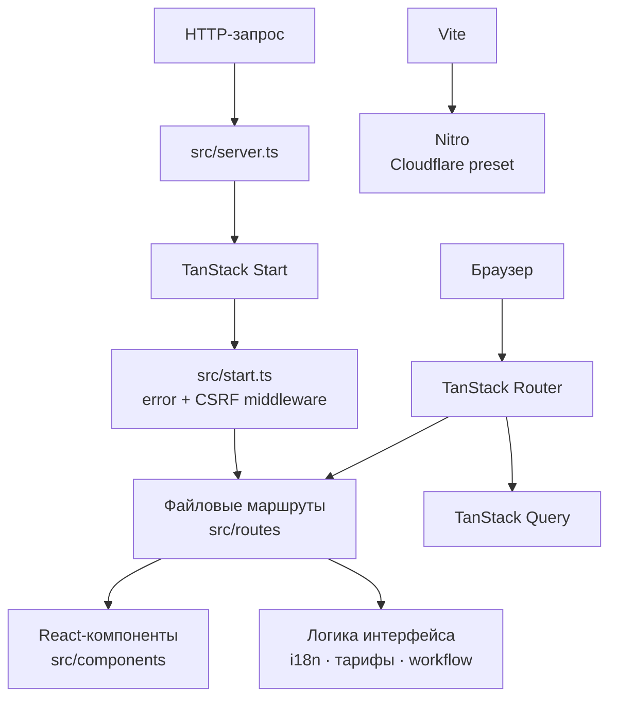

# Sweet VPN Spot

[](https://github.com/thr19203-ctrl/sweet-vpn-spot/actions/workflows/tests.yml)
[](https://github.com/thr19203-ctrl/sweet-vpn-spot/actions/workflows/lint.yml)
[](https://github.com/thr19203-ctrl/sweet-vpn-spot/actions/workflows/build.yml)

Sweet VPN Spot — адаптивный лендинг Cfg с тарифами, обзором VPN-протоколов и устройств, видео о подключении и поддержкой 20 языков. Это веб-интерфейс проекта, а не VPN-клиент или сервер.

- **Сайт:** [sweet-vpn-spot.lovable.app](https://sweet-vpn-spot.lovable.app)
- **Редактор Lovable:** [открыть проект](https://lovable.dev/projects/f49f08cf-28ea-4ee0-aee2-bed2858b3962)
- **Discord:** [присоединиться к сообществу](https://discord.gg/6DsXVJkEJw)

## Архитектура

Приложение использует файловую маршрутизацию TanStack Router. TanStack Start связывает маршруты с серверным рендерингом; входящий SSR-запрос проходит через серверную обвязку и middleware обработки ошибок и CSRF. Vite собирает клиентскую и серверную части, а Nitro формирует Cloudflare-совместимый build.



Структура исходников:

```text
src/
├── components/       Общие UI-компоненты и видеопрезентация workflow
├── hooks/            React hooks
├── lib/              Локализация, тарифы, workflow и обработка ошибок
├── routes/           Главная страница, корневой layout и Terms of Use
├── assets/           Изображения и метаданные видео
├── router.tsx        Создание TanStack Router и QueryClient
├── start.ts          Middleware TanStack Start
├── server.ts         SSR entry point и обработка ошибок
└── styles.css        Tailwind CSS и глобальные стили
```

`src/routeTree.gen.ts` генерируется TanStack Router. Не редактируйте его вручную. Данные тарифов и расчёт цены находятся в `src/lib/pricing.ts`; словари локалей — в `src/lib/i18n.ts` и `src/lib/i18n-content.ts`.

## Технологический стек

| Область | Технологии |
|---|---|
| Язык и runtime | TypeScript, Bun |
| Интерфейс | React 19, Tailwind CSS 4, Radix UI, Lucide |
| Маршрутизация и SSR | TanStack Router, TanStack Start, TanStack Query |
| Сборка и серверный preset | Vite, Nitro (Cloudflare) |
| Тесты | Vitest, Testing Library, jsdom |
| Качество кода | ESLint, Prettier |
| Локализация | 20 языков, включая RTL для арабского |

## Быстрый запуск

Нужны Git и [Bun](https://bun.sh/docs/installation).

```sh
git clone https://github.com/thr19203-ctrl/sweet-vpn-spot.git
cd sweet-vpn-spot
bun install --frozen-lockfile
bun run dev
```

Откройте адрес, который Vite выведет в терминал.

### Проверки проекта

```sh
bun run test   # тесты Vitest
bun run lint   # ESLint и Prettier
bun run build  # production-сборка
```

## GitHub Actions

Тесты, lint и production-сборка запускаются при каждом push в ветку, а также при pull request в `main`. Pull request оформляется по шаблону `.github/pull_request_template.md`.

## Работа с Lovable

Проект связан с [Lovable](https://lovable.dev): изменения в подключённой ветке синхронизируются с редактором. Не переписывайте опубликованную историю. Сгенерированный файл маршрутов и выходные файлы сборки не добавляйте в PR без необходимости.
