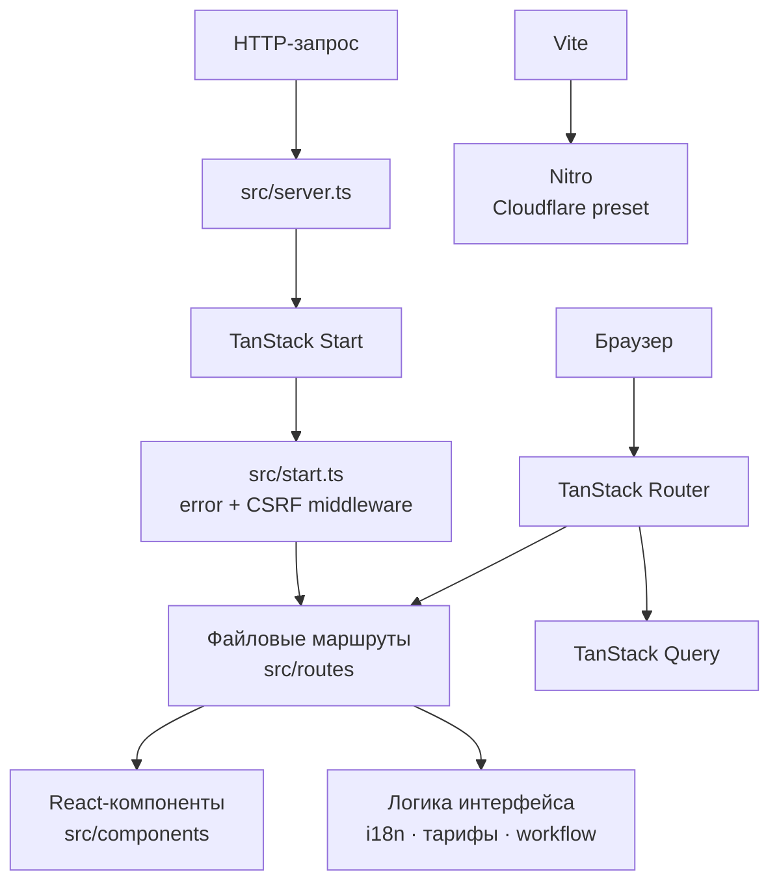

# Sweet VPN Spot

[](https://github.com/thr19203-ctrl/sweet-vpn-spot/actions/workflows/tests.yml)
[](https://github.com/thr19203-ctrl/sweet-vpn-spot/actions/workflows/lint.yml)
[](https://github.com/thr19203-ctrl/sweet-vpn-spot/actions/workflows/build.yml)

Sweet VPN Spot — адаптивный лендинг Cfg с тарифами, обзором VPN-протоколов и устройств, видео о подключении и поддержкой 20 языков. Это веб-интерфейс проекта, а не VPN-клиент или сервер.

- **Сайт:** [sweet-vpn-spot.lovable.app](https://sweet-vpn-spot.lovable.app)
- **Редактор Lovable:** [открыть проект](https://lovable.dev/projects/f49f08cf-28ea-4ee0-aee2-bed2858b3962)
- **Discord:** [присоединиться к сообществу](https://discord.gg/6DsXVJkEJw)

## Архитектура

Приложение использует файловую маршрутизацию TanStack Router. TanStack Start связывает маршруты с серверным рендерингом; входящий SSR-запрос проходит через серверную обвязку и middleware обработки ошибок и CSRF. Vite собирает клиентскую и серверную части, а Nitro формирует Cloudflare-совместимый build.



Структура исходников:

```text
src/
├── components/       Общие UI-компоненты и видеопрезентация workflow
├── hooks/            React hooks
├── lib/              Локализация, тарифы, workflow и обработка ошибок
├── routes/           Главная страница, корневой layout и Terms of Use
├── assets/           Изображения и метаданные видео
├── router.tsx        Создание TanStack Router и QueryClient
├── start.ts          Middleware TanStack Start
├── server.ts         SSR entry point и обработка ошибок
└── styles.css        Tailwind CSS и глобальные стили
```

`src/routeTree.gen.ts` генерируется TanStack Router. Не редактируйте его вручную. Данные тарифов и расчёт цены находятся в `src/lib/pricing.ts`; словари локалей — в `src/lib/i18n.ts` и `src/lib/i18n-content.ts`.

## Технологический стек

| Область | Технологии |
|---|---|
| Язык и runtime | TypeScript, Bun |
| Интерфейс | React 19, Tailwind CSS 4, Radix UI, Lucide |
| Маршрутизация и SSR | TanStack Router, TanStack Start, TanStack Query |
| Сборка и серверный preset | Vite, Nitro (Cloudflare) |
| Тесты | Vitest, Testing Library, jsdom |
| Качество кода | ESLint, Prettier |
| Локализация | 20 языков, включая RTL для арабского |

## Быстрый запуск

Нужны Git и [Bun](https://bun.sh/docs/installation).

```sh
git clone https://github.com/thr19203-ctrl/sweet-vpn-spot.git
cd sweet-vpn-spot
bun install --frozen-lockfile
bun run dev
```

Откройте адрес, который Vite выведет в терминал.

### Проверки проекта

```sh
bun run test   # тесты Vitest
bun run lint -- --rule 'prettier/prettier: off'  # ESLint, без старых ошибок форматирования
bun run build  # production-сборка
```

## GitHub Actions

Тесты, линтинг и production-сборка запускаются при каждом push в ветку, а также при pull request в `main`. Линт-проверка запускает правила ESLint; Prettier-форматирование пока исключено, поскольку в существующих файлах есть нарушения форматирования. Шаблон PR находится в `.github/pull_request_template.md`.

## Работа с Lovable

Проект связан с [Lovable](https://lovable.dev): изменения в подключённой ветке синхронизируются с редактором. Не переписывайте опубликованную историю. Сгенерированный файл маршрутов и выходные файлы сборки не добавляйте в PR без необходимости.

## Безопасность и отказоустойчивость

> Ниже описан план, а не уже включённые production-настройки. `vite.config.ts` задаёт Nitro Cloudflare preset для сборки, но это не включает правила WAF/Rate Limiting и не подтверждает, что публичный сайт уже проходит через Cloudflare Proxy. В репозитории пока нет Docker/PM2-конфигурации, health endpoints и внешних uptime-алертов.

### Защита от DDoS

Cloudflare автоматически смягчает крупные DDoS-атаки, но это не исключает нагрузку на приложение. Рекомендуемая схема — совместить управляемые DDoS-правила, WAF и ограничения запросов, а статические ресурсы кэшировать на edge.[2]

1. Подключить публичный домен через Cloudflare Proxy и проверить, что активны управляемые DDoS-правила. Если у проекта есть отдельный origin, закрыть прямой доступ к нему и принимать трафик только через Cloudflare.[2]
2. Создать Rate Limiting rules для динамических и ресурсоёмких маршрутов, а не для всех файлов сайта. Учитывать путь, HTTP-метод и подходящий идентификатор клиента; пороги выбирать по реальному трафику и доступным функциям плана Cloudflare.[1]
3. Начинать с осторожных порогов, наблюдать за ложными срабатываниями и затем настраивать challenge или блокировку. Cloudflare предупреждает, что Rate Limiting не является точным жёстким лимитом и может срабатывать с небольшой задержкой.[1]
4. Если появятся формы или публичные API, отдельно ограничить частые `POST`-запросы и защищать чувствительные операции. Не записывать в логи секреты и содержимое конфигураций.

### Автоматическое восстановление процессов

Конфигурация сборки задаёт Nitro Cloudflare preset, но фактическую production-платформу нужно подтвердить отдельно. Если приложение развёрнуто как Cloudflare Worker, используйте наблюдаемость платформы. PM2 и Docker в репозитории не настроены; рекомендации ниже относятся только к самостоятельному Node.js-развёртыванию.

- **Docker:** задавать одну restart policy, например `unless-stopped` или `on-failure` с ограничением повторов. Добавить `HEALTHCHECK` и readiness/liveness probes оркестратора. Docker рекомендует не сочетать restart policy контейнера с отдельным host-level process manager.[4][5]
- **Node.js без Docker:** использовать один менеджер, например PM2 или systemd, с автозапуском после перезагрузки, задержкой и пределом частоты рестартов. PM2 поддерживает сохранение списка процессов и восстановление при старте системы.[6] Задержку и предел числа рестартов можно задать в конфигурации PM2.[7]
- В обоих вариантах настроить graceful shutdown, понятные логи и ограниченные повторы с backoff. Бесконечный быстрый restart-loop может скрыть первопричину и ухудшить доступность.

### Мониторинг здоровья

1. **Проверки доступности:** настроить внешние HTTPS-проверки главной страницы и `/terms` из нескольких регионов. Отдельные `/healthz` (процесс отвечает) и `/readyz` (приложение готово обслуживать запросы) можно добавить, если появятся серверные зависимости. Сейчас таких endpoints в проекте нет.
2. **Метрики Cloudflare Workers:** отслеживать число запросов, ошибки, CPU time и длительность выполнения; использовать логи и traces для разбора отдельных запросов.[3]
3. **Алерты:** уведомлять об устойчивом росте 5xx и ошибок, недоступности сайта, резком росте 429, ухудшении задержки, проблемах TLS/DNS и неудачных деплоях. Пороги определить после сбора базового профиля трафика.
4. **Разбор инцидента:** сопоставить время сбоя с последним деплоем, проверить метрики и логи, при атаке ужесточить edge-правила, при регрессии откатить последний релиз.

Статусные бейджи GitHub Actions показывают результат тестов, lint и сборки, но не подтверждают доступность production-сайта.

## Sources

[1] https://developers.cloudflare.com/waf/rate-limiting-rules — Cloudflare rate limiting rules
[2] https://developers.cloudflare.com/ddos-protection/best-practices/proactive-defense — Cloudflare proactive DDoS defense
[3] https://developers.cloudflare.com/workers/observability — Cloudflare Workers observability
[4] https://docs.docker.com/engine/containers/start-containers-automatically — Docker restart policies
[5] https://docs.docker.com/reference/dockerfile — Docker health checks
[6] https://pm2.io/docs/runtime/guide/process-management — PM2 process management
[7] https://pm2.io/docs/runtime/reference/raw_data/ecosystem-file — PM2 restart controls.
